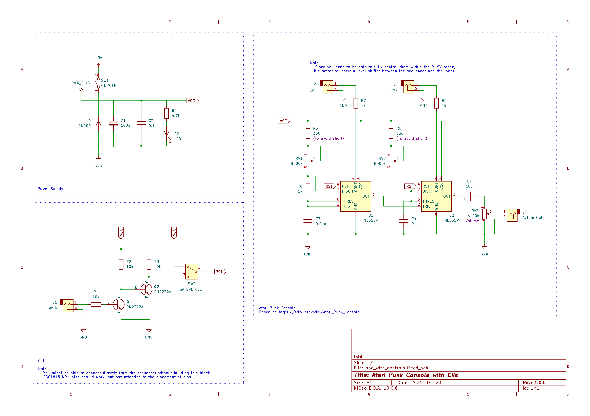
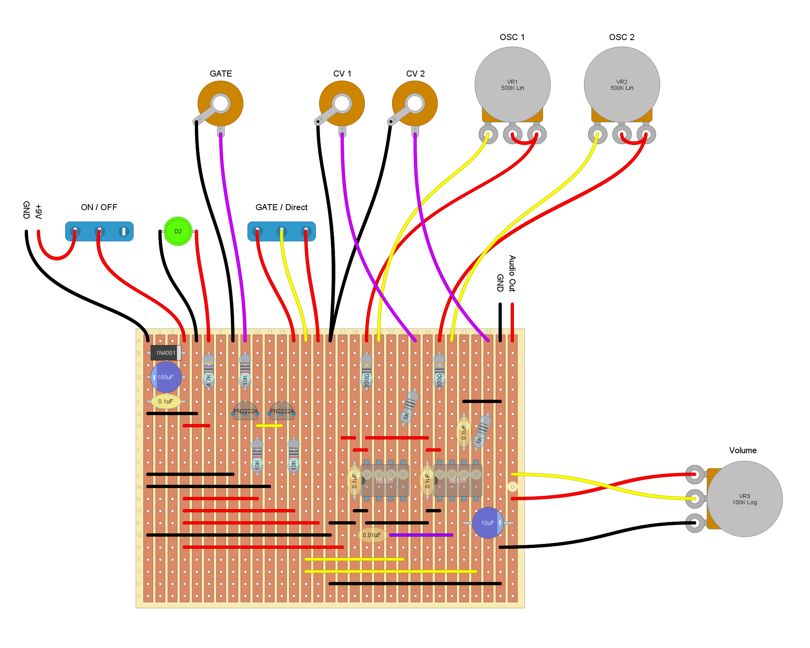

# Atari Punk Console with CVs

An Atari Punk Console with dual NE555, GATE and CV Inputs.  

## Schematic
You can check the behavior of the GATE section through simulation.  
In [LTSpice](https://www.analog.com/en/resources/design-tools-and-calculators/ltspice-simulator.html), open the `spice/GATE.asc` file and run the simulation.

## Stripboard Layout

## License
[MIT License](./LICENSE)  
Originally designed by [Forrest Mims](https://en.wikipedia.org/wiki/Forrest_Mims), and then named by Kaustic Machines in the 1980s.